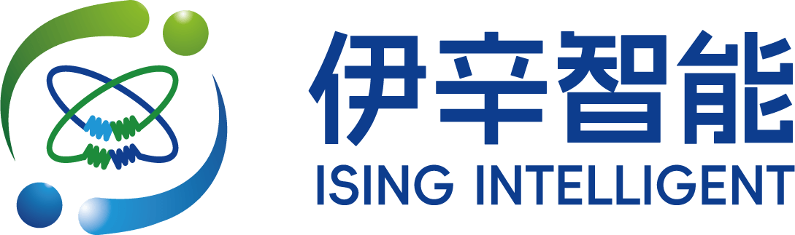

<p align="center">
  
</p>

<h1 align="center">IsingQ Toolkit</h1>

> 本文对应 **0.9.x**。安装包以 [npm](https://www.npmjs.com/package/@ising-tech/isingq-mcp) 和 [GitHub Releases](https://github.com/ising-tech/isingq-toolkit/releases) 实际发布为准，源码不代表已发布；安装后核对 Host 实际加载的版本。

<p align="center">
  让 Agent 帮助你完成 QUBO 建模、校验，并调用云端或内网本地求解器
</p>

<p align="center">
  简体中文 · <a href="README.en.md">English</a> ·
  <a href="#快速开始">快速开始</a> ·
  <a href="https://console.isingq.com/">获取 API Key</a>
</p>

<p align="center">
  <a href="https://www.npmjs.com/package/@ising-tech/isingq-dsh-plugin"></a>
</p>

<p align="center">
  
</p>

> 旧版流程示意；工具数量以当前版本为准。

支持标准 MCP、Codex Plugin 和 DeepSeek Harness 原生 Plugin。

## 快速开始

推荐把下面这段话发给当前 Agent：

```text
请读取 https://github.com/ising-tech/isingq-toolkit 中的
skills/install-isingq-mcp/SKILL.zh-CN.md，帮我安装 IsingQ MCP，
只接入当前 Agent。安装后重连，按实际版本和入口核对工具及加载版本。
本地求解不配置云端 API Key；需要云端时再通过安全输入框配置。
不要在对话中索要或显示 API Key。
```

手动接入标准 MCP 需要 Node.js 18.17+ 和 npm：

```bash
npx @ising-tech/isingq-mcp configure-host --name generic --npx
```

将输出的 stdio JSON 导入 Host 的 MCP 设置，再重连 `isingq`；无法动态重载时再重启。`generic` 也可替换为 `workbuddy`、`codex`、`claude-code`、`cursor` 或 `vscode`，只配置实际使用的 Host。

npm/npx 获取已发布包。使用下述 0.9.x 能力前，请确认加载版本达到 0.9；未发布的本地候选按[开发说明](https://github.com/ising-tech/isingq-toolkit/blob/main/docs/DEVELOPMENT.md)运行。

其他接入方式：

- **无需 Node.js**：从 [GitHub Releases](https://github.com/ising-tech/isingq-toolkit/releases) 下载对应系统的独立程序，用同一 Release 的 `SHA256SUMS` 校验后注册 `serve` 入口。
- **Codex Plugin**：先运行 `codex plugin marketplace add ising-tech/isingq-toolkit --ref main`，再运行 `codex plugin add isingq-mcp@isingq-toolkit`，新建任务后验证连接。
- **DeepSeek Harness**：使用[原生 Plugin](https://github.com/ising-tech/isingq-toolkit/tree/main/packages/dsh-plugin#readme)，同一个 Profile 不重复启用 IsingQ MCP Bridge。

### 安装演示

<p align="center">
  
</p>

## 基本使用

直接描述问题，例如：

```text
请把 A、B、C 分为两组，让跨组边权之和最大：AB=3、AC=2、BC=1，
两组人数不限。先展示变量、目标函数、约束和矩阵摘要。
确认求解时让我选择云端机型或本地设备，等我确认后再提交。
```

1. **建模**：Agent 先展示模型；仅建模、校验不需要云端 API Key。
2. **选择目标**：确认求解时展示可选机型与适配建议，选择后继续给建议；建议不阻塞用户选择。
3. **确认并提交**：核对本次目标、数据去向和资源使用，明确确认后才提交。
4. **查看任务**：让 Agent 查询该次调用记录，或打开记录对应的实际查阅位置。

| 求解目标 | 首次配置 | 资源使用 | 任务查阅位置 |
| --- | --- | --- | --- |
| 云端 | 在[云平台](https://console.isingq.com/api-keys)创建个人 API Key，再让 Agent 打开 `isingq_api_key_setup` 安全输入框 | 提交前选择算力券或账户余额 | 该笔任务对应的云平台入口 |
| 本地 | 对 Agent 说“添加／管理本地求解器”，在配置页填写连接名称和服务地址，测试连接 | 占用所选设备，不使用云端算力券或余额 | 该笔任务对应的本地可访问地址 |

本地可保存多台具名设备；保存配置不会提交求解。云端公开机型目录无需个人 Key，实际云端求解才需要。API Key 不应写入聊天、MCP JSON 或日志。

## 工具与版本

以下数量适用于 0.9.x，按 Host 实际加载的入口核对：

| 入口 | 工具数量 |
| --- | ---: |
| 标准 MCP 默认入口（`serve`） | 4 |
| 标准 MCP 技术入口（`serve --technical`） | 20 |
| DSH 原生 Plugin | 21 |

默认 MCP 提供 `isingq_api_key_setup`、`isingq_knowledge_get`、`isingq_modeling_guide_get` 和统一的 `isingq_solve`。普通使用无需切到技术入口。

## 更新与帮助

Toolkit 内置版本检查只提供更新提醒；安装与重载由当前接入方式负责。专家托管入口按专家的兼容约定自动维护工具版本。

- **工具缺失或版本未变**：核对连接来源和实际加载版本，先重连，必要时重启；避免重复安装多套入口。
- **本地设备不可用**：检查设备网络和服务地址，在管理页测试连接；不需要为此配置云端 Key。
- **云端鉴权失败**：通过安全输入框更换 Key，不要发到对话中。

[开发与集成说明](https://github.com/ising-tech/isingq-toolkit/blob/main/docs/DEVELOPMENT.md) · [求解目标接口](https://github.com/ising-tech/isingq-toolkit/blob/main/docs/solver-targets.md) · [Core SDK](packages/core/README.md) · [安全说明](SECURITY.md) · [Apache-2.0](LICENSE)
